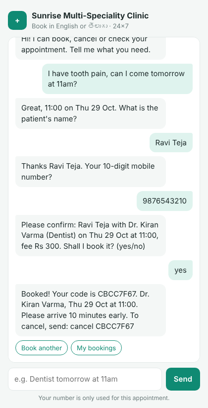
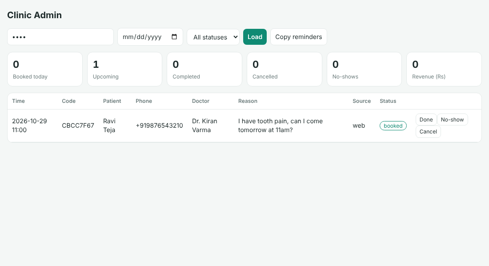

# AI Clinic Booking Automation

An AI receptionist for small clinics. Patients book, cancel and check appointments in **English or Telugu**, on the website or on **WhatsApp**, 24x7. The clinic staff get a simple admin dashboard.

| Patient chat | Admin dashboard |
|---|---|
|  |  |

## Features

- **Natural-language booking.** "I have tooth pain, can I come tomorrow at 11am?" picks the dentist, the date and the time in one message.
- **English + Telugu** (రేపు, ఎల్లుండి, పంటి నొప్పి, జ్వరం …). Replies switch to Telugu automatically.
- **Real slot engine.** Doctor working days, hours and slot length. No double booking (enforced in the database too). Suggests the nearest free times.
- **Cancel / lookup** by booking code + phone number.
- **WhatsApp bot** via a Twilio webhook (`/webhook/whatsapp`).
- **Admin dashboard** (`/admin`): daily list, mark done / no-show / cancel, stats, revenue, and one-click reminder messages for tomorrow's patients.
- **Optional LLM** (Groq, OpenAI, Ollama or any OpenAI-compatible API) for messy free-form messages. It works fully offline without one.
- 16 automated tests, Docker support.

## Tech stack

Python · FastAPI · SQLite · vanilla HTML/JS · optional LLM (OpenAI-compatible) · Twilio WhatsApp

## Run it locally

```bash
git clone https://github.com/manikantar585-lgtm/AI-clinic-booking-automation.git
cd AI-clinic-booking-automation
python -m venv .venv && source .venv/bin/activate   # Windows: .venv\Scripts\activate
pip install -r requirements.txt
cp .env.example .env        # edit clinic name, admin token, optional LLM key
uvicorn app.main:app --reload
```

- Patient chat: http://localhost:8000
- Admin: http://localhost:8000/admin (use the `ADMIN_TOKEN` from `.env`)
- API docs: http://localhost:8000/docs

Run the tests with `pytest -q`.

## Connect WhatsApp (Twilio sandbox)

1. Create a free Twilio account and open **Messaging → Try it out → WhatsApp sandbox**.
2. Expose your app: `ngrok http 8000` (or deploy it, see below).
3. Set **"When a message comes in"** to `https://<your-url>/webhook/whatsapp` (POST).
4. Send "hi" to the sandbox number from WhatsApp.

## Deploy

Any host that runs Docker or Python works (Render, Railway, a VPS):

```bash
docker build -t clinic-bot .
docker run -p 8000:8000 -v clinic-data:/data -e ADMIN_TOKEN=secret clinic-bot
```

## API

| Method | Path | What it does |
|---|---|---|
| POST | `/api/chat` | `{session_id, message}` → assistant reply + quick-reply options |
| GET | `/api/doctors` | List doctors |
| GET | `/api/doctors/{id}/slots?date=YYYY-MM-DD` | Free slots |
| POST | `/api/appointments` | Book directly |
| GET | `/api/appointments/{code}?phone=` | Look up a booking |
| POST | `/api/appointments/{code}/cancel` | Cancel (needs phone) |
| GET | `/api/admin/stats` | Dashboard numbers (header `X-Admin-Token`) |
| GET | `/api/admin/appointments` | Filter by date / status / doctor |
| POST | `/api/admin/appointments/{code}/status` | completed / no_show / cancelled |
| POST | `/api/admin/doctors` | Add a doctor |
| GET | `/api/admin/reminders?date=` | Ready-to-send reminder texts |
| POST | `/webhook/whatsapp` | Twilio WhatsApp webhook |

## Project structure

```
app/
  main.py        FastAPI routes
  assistant.py   dialogue manager + English/Telugu parsing + optional LLM
  booking.py     slots, booking, cancel, stats, reminders
  db.py          SQLite schema + seed doctors
  config.py      settings from .env
static/          patient chat + admin pages
tests/           pytest suite
```

## Customising for a clinic

Edit the doctors in `app/db.py` (`SEED_DOCTORS`) or add them through `POST /api/admin/doctors`, then set `CLINIC_NAME` and `CLINIC_PHONE` in `.env`.

## Author

Kunduru Manikanta Reddy · [LinkedIn](https://linkedin.com/in/manikanta-reddy-9a030932a) · [GitHub](https://github.com/manikantar585-lgtm)
