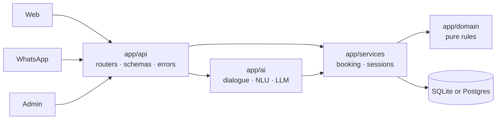

# AI Clinic Booking Assistant

[](https://github.com/manikantar585-lgtm/AI-clinic-booking-automation/actions/workflows/ci.yml)


An AI receptionist for small clinics. Patients book, cancel and check appointments in **English,
Telugu or Hinglish**, on the website or on **WhatsApp**, 24x7. Clinic staff get an admin dashboard.

| Patient chat | Admin dashboard |
|---|---|
|  |  |

## Highlights

- **One message can fill a whole booking.** "I have tooth pain, can I come tomorrow at 11am?"
  picks the dentist, the date and the time.
- **Rules first, LLM second.** A deterministic multilingual parser handles most messages offline.
  An optional LLM (any OpenAI-compatible API) covers the rest. Its output is schema-validated and
  checked against real doctors and dates, and any failure falls back silently. [Why →](docs/adr/0002-rules-first-llm-fallback.md)
- **Emergency-aware.** "Chest pain", "can't breathe", "ఛాతీ నొప్పి" or signs of self-harm skip the booking flow and show
  tap-to-call 108 / Tele-MANAS 14416 straight away. A dedicated safety eval requires 100% recall in CI.
- **Reschedule, cancel, look up.** Patients can move a booking in one message ("reschedule CB1A2B3C to friday 4pm").
  The code stays the same.
- **Front-desk dashboard.** Day view with one-click Done / No-show / Move / Cancel, doctor leave management that flags
  affected patients, monthly CSV export, and an **Insights** tab (outcomes per day, busiest hours, revenue and no-shows
  by doctor, booking channels).
- **Automatic WhatsApp reminders** through Twilio, sent daily at a set hour. Each patient gets each reminder only once.
- **Measured NLU quality.** A labelled eval set scores the parser per field, and CI fails on a regression.
- **No double booking**, even under concurrent requests: an atomic check-then-insert plus a partial unique index.
- **Secure by default.** Constant-time admin auth, Twilio signature verification, rate limiting,
  privacy-safe lookups. Production refuses to start with a default secret.
- **Easy to operate.** JSON logs with request ids, `/health` and `/ready` probes, versioned DB
  migrations, and a non-root Docker image.

## Quick start

```bash
git clone https://github.com/manikantar585-lgtm/AI-clinic-booking-automation.git
cd AI-clinic-booking-automation
python -m venv .venv && source .venv/bin/activate   # Windows: .venv\Scripts\activate
pip install -r requirements-dev.txt
cp .env.example .env
uvicorn app.main:app --reload
```

| | URL |
|---|---|
| Patient chat | http://localhost:8000 |
| Admin (`ADMIN_TOKEN` from `.env`) | http://localhost:8000/admin |
| OpenAPI docs (non-production) | http://localhost:8000/docs |

Or with Docker: `docker compose up --build`.

## Architecture



```
app/
  core/        settings, logging, errors, security, database + migrations
  domain/      entities, status transitions, slot arithmetic (no I/O)
  services/    BookingService, SessionStore
  ai/          assistant (state machine), nlu (rules), llm (extractor), prompts, messages
  api/         schemas, dependencies, error envelope, routes/{public,chat,admin,whatsapp,health}
evals/         labelled NLU dataset + runner
tests/         unit/ and integration/ (160 tests, 96% coverage)
docs/          architecture.md, adr/
```

See **[docs/architecture.md](docs/architecture.md)** for the request lifecycle, AI design and security model.

## Quality gates

| Check | Command |
|---|---|
| Lint + format | `ruff check app tests evals && ruff format --check app tests evals` |
| Types | `mypy` (strict) |
| Tests + coverage ≥ 90% | `pytest --cov` |
| NLU eval | `python -m evals.run --show-failures` |
| Safety eval (100% recall required) | `python -m evals.run --suite safety` |
| Everything | `make check` |

Current rule-parser scores on the 30-case eval set:

| intent | specialty | date | time | overall |
|---|---|---|---|---|
| 100% | 86.7% | 100% | 96.7% | **95.8%** |

The remaining misses are all `hard-*` cases ("my wife is expecting…", "itchy patches…").
Those need semantic understanding, so the LLM handles them. To score a model on the same set:
`python -m evals.run --extractor llm`.

## API

All errors have one shape: `{"error": {"code", "message", "details"?}, "request_id"}`.

| Method | Path | Notes |
|---|---|---|
| POST | `/api/chat` | `{session_id, message}` → `{text, options, appointment?}` · rate-limited |
| GET | `/api/doctors` | |
| GET | `/api/doctors/{id}/slots?date=` | |
| POST | `/api/appointments` | `201`, or `409` if the slot is taken |
| GET | `/api/appointments/{code}?phone=` | code + phone must match, else `404` |
| POST | `/api/appointments/{code}/cancel` | `{phone}` |
| POST | `/api/appointments/{code}/reschedule` | `{phone, date, time}`, keeps the same code |
| GET | `/api/admin/stats` | header `X-Admin-Token` |
| GET | `/api/admin/appointments` | `date`, `status`, `doctor_id`, `limit`, `offset` |
| POST | `/api/admin/appointments/{code}/status` | validated transitions, `409` on an illegal one |
| POST | `/api/admin/appointments/{code}/reschedule` | `{date, time}` |
| GET | `/api/admin/appointments.csv?from=&to=` | spreadsheet export |
| GET | `/api/admin/insights?days=30` | analytics for the Insights tab |
| POST | `/api/admin/doctors` | |
| GET / POST / DELETE | `/api/admin/leaves`, `/api/admin/doctors/{id}/leaves`, `/api/admin/leaves/{id}` | doctor leave. POST returns clashing bookings |
| POST | `/api/admin/reminders/send?date=` | send reminders via WhatsApp (idempotent) |
| GET | `/api/admin/reminders?date=` | ready-to-send reminder texts |
| POST | `/webhook/whatsapp` | Twilio, signature-verified when `TWILIO_AUTH_TOKEN` is set |
| GET | `/health`, `/ready` | liveness / readiness |

## WhatsApp (Twilio)

1. Twilio console → **Messaging → Try it out → WhatsApp sandbox**.
2. Expose the app (`ngrok http 8000`) or deploy it.
3. Set *When a message comes in* to `https://<host>/webhook/whatsapp` (POST).
4. Set `TWILIO_AUTH_TOKEN` and `PUBLIC_BASE_URL` so requests are signature-checked. Verified
   senders skip the phone-number question and can manage their own bookings.

## Deploy for free (Render + Neon)

The app uses SQLite locally. When `DATABASE_URL` is set it uses Postgres instead, so a free host keeps
its data across restarts.

1. **Database:** create a free project at [neon.tech](https://neon.tech) and copy the connection string
   (`postgresql://...?sslmode=require`).
2. **App:** click [Deploy to Render](https://render.com/deploy?repo=https://github.com/manikantar585-lgtm/AI-clinic-booking-automation),
   sign in with GitHub, paste the Neon string into `DATABASE_URL`, leave the other fields blank, and click **Apply**.
3. Open the URL Render gives you. The admin token is under **Environment → `ADMIN_TOKEN`** in Render.

Tables are created automatically on first start. Render's free plan sleeps after 15 minutes idle
(the first request then takes about 50 s). A free uptime monitor pinging `/health` keeps it awake.

Any other Docker host works too:

```bash
docker build -t clinic-bot .
docker run -p 8000:8000 -e ENV=production -e ADMIN_TOKEN=<strong-secret> -e DATABASE_URL=<postgres-url> clinic-bot
```

All settings are documented in [.env.example](.env.example).

## Contributing

See [CONTRIBUTING.md](CONTRIBUTING.md) and [CHANGELOG.md](CHANGELOG.md).

## Author

Kunduru Manikanta Reddy · [LinkedIn](https://linkedin.com/in/manikanta-reddy-9a030932a) · [GitHub](https://github.com/manikantar585-lgtm)
