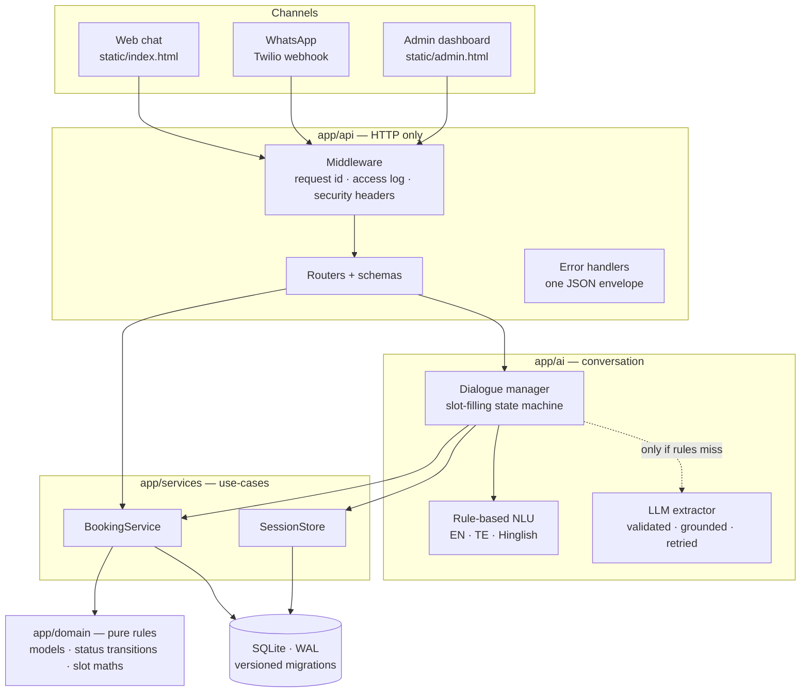

# Architecture

## Layers

Dependencies point downward only: `api → ai → services → domain`. The domain package has
no I/O, so it is tested without a database or HTTP.

## Request lifecycle (chat message)

1. **Middleware** assigns a request id (or reuses `X-Request-ID`), and every log line carries it.
2. **Rate limiter** (`/api/chat`) rejects more than N messages a minute from one client with a 429.
3. **Assistant** loads the session state. A session idle for longer than `SESSION_TTL_MINUTES` starts fresh.
4. **Understanding**: the rule parser runs first. The LLM is called only when the conversation is
   at a doctor/date/time step *and* the rules found nothing. Name, phone and confirmation turns never
   reach the LLM.
5. **Absorb**: one message can fill several fields ("tooth pain tomorrow 11am" fills doctor, date and time).
6. **Next question**: ask for the first missing field, or confirm.
7. **Book**: `BEGIN IMMEDIATE` → re-check the slot → insert. A partial unique index on
   `(doctor_id, date, time) WHERE status='booked'` is a second guard against double booking.

## AI design

| Concern | Approach |
|---|---|
| Cost / latency | Rules first. The LLM is a fallback, not the default path. |
| Untrusted output | Pydantic schema that drops invalid fields one at a time. Then grounding: the doctor must exist and the date can't be in the past. |
| Availability | Short timeouts, jittered retries on 408/429/5xx, and any failure counts as "nothing extracted", so the patient never sees an LLM error. |
| Prompt injection | The patient's text goes inside `<message>` tags and is declared to be data. Closing tags are stripped. The model can only fill fields, never take actions. |
| Traceability | `PROMPT_VERSION`, model, latency and tokens are logged on every call. |
| Quality | `evals/` holds a labelled NLU set. CI fails if rule accuracy drops below the gate. `--extractor llm` scores any model on the same set. |

## Safety layer

`app/ai/safety.py` runs first on every message, before intent detection and before any LLM call. A red flag
(cardiac, breathing, stroke, unconsciousness, seizure, heavy bleeding, poisoning, obstetric emergency, self-harm)
returns an alert reply that the UI renders as tap-to-call buttons. The patient's booking in progress is kept.
It is keyword-based on purpose: offline, instant and auditable. Negations are respected ("no chest pain").
`evals/datasets/safety.jsonl` gates **100% recall** plus specificity in CI. A missed emergency is the one
regression that can never ship.

## Background work

Reminders are sent by `BookingService.send_reminders` through a `Notifier` (Twilio, or a disabled stub). It is
idempotent: `reminder_sent_at` is stamped only after the provider accepts the message, and rescheduling clears it.
An optional in-process loop (`app/services/scheduler.py`) runs it daily at `REMINDER_SEND_HOUR`. Because the job is
idempotent, restarts or a manual "Send all" can't double-message anyone.

## Security model

| Surface | Control |
|---|---|
| Admin API | `X-Admin-Token`, compared in constant time. Production refuses to start with a default token. |
| WhatsApp webhook | Twilio HMAC signature check when `TWILIO_AUTH_TOKEN` is set. Only a signed sender's number counts as verified. |
| Patient lookups | Code **and** phone required over HTTP, and every mismatch is a 404 so codes can't be enumerated. On web chat, "my bookings" masks codes and hides doctors, because anyone can type any phone number there. On verified WhatsApp it shows full details. |
| Session hijack | Web session ids can't contain `:`, so a web client can't address a server-side `wa:` session. |
| Abuse | Per-client rate limit on chat, request size limits on every schema, security headers. |

**Known limits.** The rate limiter keeps its counts in memory, so with more than one replica it needs a shared store (Redis). Web
chat has no OTP, so it can't prove phone ownership, which is why lookups there are masked.

## Data

Schema changes are append-only entries in `app/core/database.py::MIGRATIONS`, tracked with
`PRAGMA user_version`. Startup applies any pending migrations. Databases created before
versioning upgrade in place.
